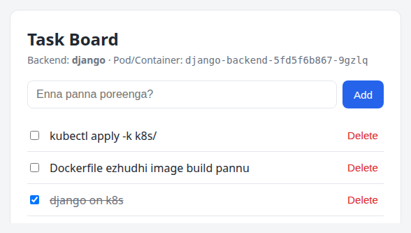

# Indha Guide Eppadi Padikkanum

Docker, Kubernetes pathi YouTube-la 100 video paathirupom. `docker run` theriyum, `kubectl get pods` theriyum. Aana interview-la *"Pod CrashLoopBackOff-la irukku, eppadi debug pannuveenga?"* nu ketta — blank aagidum. Problem enna na, naama **command** kathukittom, **concept** kathukala.

Indha guide-oda goal simple: **oru real full-stack project-a eduthu, adha Docker-la pack panni, Kubernetes-la run panni, ovvoru step-layum "ulla enna nadakkudhu" nu purinjikradhu.**

## Indha guide-la enna irukku

| Part | Topic | Level |
|---|---|---|
| Part 0 | Project overview, setup | Beginner |
| Part A | Container basics, Docker commands, Dockerfile, multi-stage | Beginner |
| Part B | Networking, volumes, Docker Compose, config | Intermediate |
| Part C | Image optimization, security, Docker internals, registry | Advanced |
| Part D | Kubernetes architecture, Pods, Deployments, Services, ConfigMaps | Beginner → Intermediate |
| Part E | Storage, StatefulSet, probes, Jobs, resources, Ingress, full deploy | Intermediate |
| Part F | Autoscaling, scheduling, security, Kustomize/Helm, debugging, production | Advanced |
| Part G | Hands-on labs, cheat sheets, interview Q&A | Practice |

Ovvoru chapter-layum indha boxes varum:

!!! tip "Tip"
    Practical shortcut or best practice.

!!! warning "Common Mistake"
    Neraya per panra thappu — idha avoid pannunga.

!!! interview "Interview Point"
    Interview-la kekka vaaipu irukka concept — senior-level answer.

!!! lab "Try Pannunga"
    Hands-on — padichadha udane terminal-la try pannunga. Padikkuradhu 30%, try panradhu 70%.

## Padikkura order

1. **Beginner-a irundha:** Part 0 → A → B → D. Ovvoru command-um type pannunga, copy-paste pannadheenga.
2. **Docker already theriyum na:** Part C (internals) quick-a paathutu Part D-la irundhu start pannunga.
3. **Interview prep:** Part C, E, F-la irukka "Interview Point" boxes + Part G Q&A.

!!! note "Golden Rule"
    Ovvoru YAML file-um, ovvoru Dockerfile line-um — *"idhu illana enna aagum?"* nu ungala neengale kelunga. Andha question-ku answer theriyum na, adhu purinjiduchu nu artham.

# Namma Project — Task Board

Oru simple **Task Board** app (todo list maadhiri) build pannirukkom. Simple-a irukkaradhu purposely — app logic easy-a irundha, focus fully Docker/Kubernetes mela irukkum.

<div class="screenshot" markdown="1">

</div>
<p class="caption">Kubernetes-la run aagura Django stack. Header-la pod name theriyudhu — refresh panna vera pod name varum (load balancing!).</p>

## Rendu stack, orey contract

Same app-a **rendu backend**-la ezhudhirukkom:

- **Django 5.2** (Python) + gunicorn
- **.NET 10** Minimal API (C#) + EF Core

Rendu backend-um **exact same REST API** expose pannum. Adhanala **orey frontend** (nginx + plain JavaScript) rendu backend-kum work aagum. Idhu real-world-la romba mukkiyamaana concept — *API contract*. Backend language enna nu frontend-ku kavalai illa.

| Method | Path | Body | Response |
|---|---|---|---|
| GET | `/api/health` | — | `{"status":"ok","backend":"django","hostname":"pod-name"}` |
| GET | `/api/ready` | — | `200 {"status":"ready"}` or `503` (DB illana) |
| GET | `/api/tasks` | — | `[{id, title, done, createdAt}]` |
| POST | `/api/tasks` | `{"title":"..."}` | `201` + created task |
| PATCH | `/api/tasks/{id}` | `{"done":true}` / `{"title":"..."}` | updated task |
| DELETE | `/api/tasks/{id}` | — | `204` |

## Architecture — Docker Compose-la

```text
                   Browser  http://localhost:3000
                      │
        ┌─────────────▼──────────────┐
        │  frontend (nginx :80)      │  static HTML/JS serve pannum
        │  /api/*  ──proxy──┐        │  /api/* backend-ku forward
        └───────────────────┼────────┘
                            │  http://backend:8000   (Docker DNS)
        ┌───────────────────▼────────┐
        │  backend (Django/gunicorn) │
        └───────────────────┬────────┘
                            │  db:5432
        ┌───────────────────▼────────┐      ┌──────────────────────┐
        │  db (postgres:17-alpine)   │◄─────│ volume: django-db-data│
        └────────────────────────────┘      └──────────────────────┘
          + "migrate" one-shot container (migrations run panni exit)
```

## Architecture — Kubernetes-la

```text
 Browser ── http://django.taskapp.local ──┐      ┌── http://dotnet.taskapp.local
                                          ▼      ▼
                        ┌─────────────────────────────────┐
                        │  Ingress (nginx controller)      │  host-based routing
                        └────────┬───────────────┬────────┘
                  Service        │               │        Service
              frontend-django    ▼               ▼    frontend-dotnet
                       ┌──────────────┐   ┌──────────────┐
                       │ nginx pod    │   │ nginx pod    │   SAME image,
                       │ BACKEND_URL= │   │ BACKEND_URL= │   different env
                       │ django:8000  │   │ dotnet:8080  │
                       └──────┬───────┘   └──────┬───────┘
                Service       ▼                  ▼      Service
             django-backend                        dotnet-backend
             ┌────────┐┌────────┐          ┌────────┐┌────────┐
             │ pod  1 ││ pod  2 │◄─ HPA    │ pod  1 ││ pod  2 │
             └───┬────┘└───┬────┘          └───┬────┘└───┬────┘
                 └────┬────┘                   └────┬────┘
                      ▼   DB: tasks                 ▼   DB: dotnetdb
               ┌─────────────────────────────────────────────┐
               │ postgres-0 (StatefulSet) + PVC (1Gi)        │
               │ headless Service "postgres"                 │
               └─────────────────────────────────────────────┘
   Jobs: django-migrate, dotnet-db-init   (app start aagura munnaadi schema ready)
```

## Folder Structure

```text
docker-k8s-fullstack/
├── django-backend/          # Django REST API
│   ├── config/              #   settings.py (env-driven), urls.py, wsgi.py
│   ├── tasks/               #   models.py, views.py, urls.py, migrations/
│   ├── Dockerfile
│   └── requirements.txt
├── dotnet-backend/          # .NET 10 Minimal API
│   ├── Program.cs           #   endpoints + --init-db mode
│   ├── Models/ Data/        #   TaskItem, AppDbContext (EF Core)
│   ├── TaskApi.csproj
│   └── Dockerfile           #   multi-stage build
├── frontend/                # nginx + plain JS (rendu backend-kum common)
│   ├── nginx/default.conf.template
│   ├── public/              #   index.html, app.js, styles.css
│   └── Dockerfile
├── compose.django.yaml      # Django stack  → http://localhost:3000
├── compose.dotnet.yaml      # .NET stack    → http://localhost:3001
├── k8s/                     # Kubernetes manifests
│   ├── kustomization.yaml   #   kubectl apply -k k8s/
│   ├── 00-namespace.yaml
│   ├── postgres/            #   Secret, ConfigMap, headless Service, StatefulSet
│   ├── django/              #   ConfigMap, Secret, Job, Deployment, Service, HPA
│   ├── dotnet/              #   Job, Deployment, Service
│   ├── frontend/            #   2 Deployments + Services (same image)
│   ├── ingress.yaml
│   └── extras/              #   NetworkPolicy (advanced lab)
├── Makefile                 # shortcuts: make django-up, make k8s-deploy ...
└── docs/                    # indha PDF-oda source (Markdown → PDF)
```

!!! note "Indha PDF-la irukka code ellam real"
    Indha PDF-la "📄 file-path" nu potturukka code blocks ellam project folder-la irundhu **direct-a include** pannadhu (`docs/build_pdf.py`). Ellam Docker 29 + Kubernetes v1.37 (minikube)-la run panni verify pannadhu. Outputs-um real run-la irundhu eduthadhu.

# Setup — Tools Install

## Enna enna venum

| Tool | Edhukku | Check command |
|---|---|---|
| Docker Engine 24+ | Images build, containers run | `docker version` |
| Docker Compose v2+ | Multi-container local stack | `docker compose version` |
| kubectl | Kubernetes cluster-oda pesa | `kubectl version --client` |
| minikube | Laptop-la single-node K8s cluster | `minikube version` |
| make (optional) | Shortcut commands | `make --version` |
| Python 3.12 / .NET 10 SDK (optional) | Docker illama local-a run panna | `python3 --version`, `dotnet --list-sdks` |

!!! tip "Local language runtime thevaiyaa?"
    **Thevai illa!** Idhu dhaan Docker-oda power. Python, .NET SDK rendum Docker image-kulla irukku. Unga laptop-la Docker mattum irundha podhum. (Code edit panna IDE support-ku mattum local SDK useful.)

## Ubuntu-la install

```bash
# Docker Engine (official convenience script)
curl -fsSL https://get.docker.com | sudo sh
sudo usermod -aG docker $USER      # sudo illama docker run panna
newgrp docker                       # (or logout/login)

# kubectl
curl -LO "https://dl.k8s.io/release/$(curl -Ls https://dl.k8s.io/release/stable.txt)/bin/linux/amd64/kubectl"
sudo install -m 0755 kubectl /usr/local/bin/kubectl

# minikube
curl -LO https://storage.googleapis.com/minikube/releases/latest/minikube-linux-amd64
sudo install minikube-linux-amd64 /usr/local/bin/minikube
```

Mac-la: Docker Desktop + `brew install kubectl minikube`. Windows-la: Docker Desktop (WSL2 backend) + `winget install Kubernetes.minikube`.

!!! warning "docker group = root access"
    `docker` group-la irukka user effectively **root** maadhiri — `docker run -v /:/host` panni full filesystem access pannalaam. Personal laptop-ku OK, shared server-la yosichu pannunga.

## Verify

```bash
$ docker version --format '{{.Server.Version}}'
29.8.0
$ docker compose version
Docker Compose version v5.5.1
$ kubectl version --client
Client Version: v1.37.0
$ minikube version
minikube version: v1.39.0
$ docker run --rm hello-world
Hello from Docker!
...
```

`hello-world` output vandhuchu na — Docker daemon running, image pull aagudhu, container run aagudhu. Setup done ✅.

## Quick start (full project-a 2 nimishathula paakanum na)

```bash
cd docker-k8s-fullstack

# Docker Compose
make django-up         # → http://localhost:3000
make dotnet-up         # → http://localhost:3001

# Kubernetes
make k8s-start         # minikube + ingress + metrics-server
make k8s-load          # images build panni minikube-kulla load
make k8s-deploy        # kubectl apply -k k8s/ + wait
make k8s-hosts         # /etc/hosts-la add panna vendiya line
```

Ippo idhu ellam "magic" maadhiri theriyum. Indha guide mudiyumbodhu ovvoru command-um ulla enna pannudhu nu ungalukku theriyum. Start pannalaam 🚀
