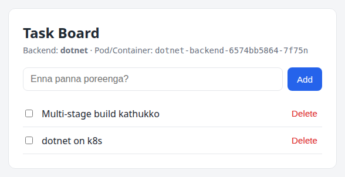

# PART E — Kubernetes Intermediate {: .part }

Database-a K8s-la eppadi run panradhu (StatefulSet + PVC), health probes correct-a design panradhu, migrations-ku Jobs, resources & QoS, Ingress — kadaisiya full stack-a end-to-end deploy.

# Storage — PV, PVC, StorageClass

<span class="level intermediate">Intermediate</span>

## Volume types

| Volume | Lifetime | Use | Namma project |
|---|---|---|---|
| `emptyDir` | Pod irukka varaikum | Scratch space, containers share | Backends `/tmp` (read-only root FS-ku) |
| `configMap` / `secret` | Object irukka varaikum | Config files | Postgres init script |
| `hostPath` | Node disk | Node agents (avoid for apps!) | — |
| `persistentVolumeClaim` | Pod-a vida independent | Databases, uploads | Postgres data |

## PV / PVC / StorageClass — 3 layers

```text
  Developer                       Cluster / Cloud
 ┌────────────────────┐        ┌──────────────────────────┐       ┌───────────────────┐
 │ PVC                │ bind   │ PV                       │       │ Actual disk       │
 │ "1Gi RWO venum"    │──────► │ 1Gi, RWO, Delete policy  │──────►│ AWS EBS / Azure   │
 │ data-postgres-0    │        │ pvc-39cc3919-...         │       │ Disk / hostPath   │
 └────────────────────┘        └──────────────────────────┘       └───────────────────┘
          │                               ▲
          │ storageClassName: standard    │ dynamic provisioning
          └──────────► StorageClass ──────┘ (provisioner: k8s.io/minikube-hostpath / ebs.csi.aws.com)
```

- **PVC (PersistentVolumeClaim)** — "Enakku 1Gi storage venum" nu request. Developer ezhudhuradhu.
- **PV (PersistentVolume)** — Actual storage piece. Admin create pannalaam, or StorageClass **dynamic-a** create pannum.
- **StorageClass** — "Eppadi disk create pannanum" (provisioner, disk type, reclaim policy).

```text
$ kubectl get storageclass
NAME                 PROVISIONER                RECLAIMPOLICY   VOLUMEBINDINGMODE
standard (default)   k8s.io/minikube-hostpath   Delete          Immediate

$ kubectl get pv
NAME                                       CAP   RECLAIM   CLAIM             PATH
pvc-39cc3919-c588-4edb-9649-54571fe27f74   1Gi   Delete    data-postgres-0   /tmp/hostpath-provisioner/taskapp/data-postgres-0
```

## Access modes

| Mode | Meaning | Example |
|---|---|---|
| `ReadWriteOnce` (RWO) | Oru **node** mount (read-write) | AWS EBS, Azure Disk — DBs |
| `ReadWriteOncePod` | Oru **pod** mattum | Strict single writer |
| `ReadOnlyMany` (ROX) | Many nodes read-only | |
| `ReadWriteMany` (RWX) | Many nodes read-write | NFS, AWS EFS, Azure Files |

## Reclaim policy

- **Delete** (dynamic default) — PVC delete → PV + actual disk **delete**. ⚠️
- **Retain** — PVC delete aanaalum disk irukkum; manual cleanup. Production DBs-ku safer.

!!! danger "kubectl delete -k k8s/ = data gone"
    Namma `make k8s-delete` namespace-ae delete pannum → PVC delete → reclaim `Delete` → Postgres data **permanent-a poidum**. Production-la: Retain policy StorageClass, volume snapshots, and regular `pg_dump` backups (CronJob).

# StatefulSet — Database-ku

<span class="level intermediate">Intermediate</span>

Deployment pods **interchangeable** — random names, shared PVC (if any), any order. Database-ku idhu work aagaadhu. **StatefulSet** guarantees:

| Guarantee | Deployment | StatefulSet |
|---|---|---|
| Pod names | `django-backend-5fd5f6b867-9gzlq` (random) | `postgres-0`, `postgres-1` (stable, ordinal) |
| Storage | Shared / none | **Per-pod PVC** (`volumeClaimTemplates`) — pod recreate aanaalum same PVC |
| DNS | Service IP mattum | Per-pod DNS: `postgres-0.postgres.taskapp.svc.cluster.local` |
| Start/stop order | Parallel | Ordered (0 → 1 → 2; stop reverse) |
| Update | Any order | Reverse ordinal, one at a time |

## Namma Postgres StatefulSet

<!-- include: k8s/postgres/statefulset.yaml -->

**`serviceName: postgres`** — headless Service name. Per-pod DNS records idhu vazhiya.

**`volumeClaimTemplates`** — Ovvoru replica-kum `data-postgres-<ordinal>` PVC auto-create. `replicas: 3` aakkina `data-postgres-1`, `data-postgres-2` create aagum (aana Postgres replication setup panna maattadhu — adhu app level!).

**`PGDATA=/var/lib/postgresql/data/pgdata`** — Cloud disks (EBS) mount panna root-la `lost+found` folder irukkum; Postgres `initdb` "directory not empty" nu fail aagum. Sub-directory = safe.

**`envFrom: secretRef`** — `POSTGRES_USER/PASSWORD/DB` official image-ku.

**`exec` probes with `pg_isready`** — HTTP illa, so command probe.

## Headless Service

<!-- include: k8s/postgres/service.yaml -->

Real DNS: `postgres` → `10.244.0.17` (pod IP direct, ClusterIP illa). Single replica-ku normal Service-um work aagum; aana StatefulSet-ku headless convention, and primary/replica setup-la `postgres-0.postgres` (primary) specific-a target pannalaam.

## Persistence — real test

```text
$ kubectl -n taskapp delete pod postgres-0
pod "postgres-0" deleted
$ kubectl -n taskapp wait --for=condition=ready pod/postgres-0
pod/postgres-0 condition met                    ← same name-oda recreate, same PVC attach
$ curl -s -H "Host: django.taskapp.local" http://$(minikube ip)/api/tasks
[{"id": 1, "title": "django on k8s", ...}]      ← data safe ✅
```

!!! interview "Interview Point: Database-a Kubernetes-la run pannalaama?"
    Technically aamaa (StatefulSet + PVC + operators). Aana **operational burden** periyadhu — backups, replication, failover, upgrades, tuning. Production-la common answer: **managed DB (AWS RDS, Azure Database for PostgreSQL, Cloud SQL)** use pannunga, K8s-la stateless apps mattum. K8s-la DB venum na **operator** use pannunga (CloudNativePG, Zalando Postgres Operator, Crunchy PGO) — avanga failover, backup, replication automate pannuvanga. Namma plain StatefulSet learning-ku mattum.

# Health Probes — Liveness, Readiness, Startup

<span class="level intermediate">Intermediate</span>

Kubelet ovvoru container-aiyum periodically check pannum. 3 probes, 3 different actions:

| Probe | Question | Fail aana | Namma endpoint |
|---|---|---|---|
| **startupProbe** | "App start aagi mudinjudha?" | Pass aagura varaikum liveness/readiness run aagaadhu; `failureThreshold × period` thaandina restart | `/api/health` (2s × 30 = 60s max) |
| **livenessProbe** | "App uyiroda irukka? (deadlock/hang illa)" | Container **RESTART** | `/api/health` |
| **readinessProbe** | "Traffic vaanga ready-a?" | Service endpoints-la irundhu **REMOVE** (restart illa) | `/api/ready` (DB check) |

## Probe mechanisms

```yaml
httpGet:   { path: /api/health, port: http }      # 200–399 = success
tcpSocket: { port: 5432 }                          # TCP connect aana success
exec:      { command: ["pg_isready"] }             # exit 0 = success
grpc:      { port: 9090 }                          # gRPC health protocol
```

Timing fields (defaults): `initialDelaySeconds: 0`, `periodSeconds: 10`, `timeoutSeconds: 1`, `failureThreshold: 3`, `successThreshold: 1`.

## Real demo — DB down aana enna aagum

Namma design correct-a work aagudha nu prove panna, Postgres-a stop pannom:

```text
$ kubectl -n taskapp scale sts/postgres --replicas=0
$ kubectl -n taskapp get pods -l 'app in (django-backend,dotnet-backend)'
NAME                              READY   STATUS    RESTARTS   AGE
django-backend-5fd5f6b867-9gzlq   0/1     Running   0          14m    ← NOT READY, aana
django-backend-5fd5f6b867-b7fsk   0/1     Running   0          14m       RESTARTS 0 ✅
dotnet-backend-6574bb5864-7f75n   0/1     Running   0          16m
dotnet-backend-6574bb5864-zffnn   0/1     Running   0          16m

$ curl -s -o /dev/null -w "%{http_code}" -H "Host: django.taskapp.local" http://$(minikube ip)/api/tasks
502                                       ← ready backends illa, nginx 502

$ kubectl -n taskapp scale sts/postgres --replicas=1     # DB thirumba
$ kubectl -n taskapp get pods -l 'app in (django-backend,dotnet-backend)'
django-backend-5fd5f6b867-9gzlq   1/1     Running   0          15m    ← auto READY, restart illama
django-backend-5fd5f6b867-b7fsk   1/1     Running   0          15m
```

`/api/ready` fail → pods NotReady → traffic stop. `/api/health` pass → restart illa. DB vandha udane readiness pass → traffic resume. **Zero manual intervention.**

!!! danger "Classic mistake: Liveness probe-la dependency check"
    Liveness `/api/ready` (DB check) vecha — DB 1 min down aana, **ellam backend pods-um restart**. DB vandha apram kooda ellam pods orey nerathula start aagi DB-a hammer pannum (thundering herd). Restart DB problem-a fix pannadhu — app-la problem illa! **Rule: liveness = "naan stuck-a irukkena?" mattum. External dependencies readiness-la mattum.**

!!! warning "Other probe mistakes"
    - **Liveness timeout romba chinnadhu** — GC pause / load-la 1s-ku mela aana unnecessary restarts. Heavy apps-ku `timeoutSeconds: 3-5`.
    - **startupProbe illama slow app** — Java/.NET app 40s start aagum, liveness 30s-la kill → infinite CrashLoop. startupProbe use pannunga (namma 60s budget).
    - **Readiness illama** — pod start aana udane traffic → app ready illana 502s during rollout.
    - **ALLOWED_HOSTS** — Django probes `400 DisallowedHost` (Part A-la paathom).

## Graceful termination — preStop hook (real bug we hit!)

Indha project build pannumbodhu, rollout-la `curl` loop odavittom (120 requests):

```text
# preStop hook ILLAMA
$ kubectl -n taskapp rollout restart deploy/django-backend
    118 200
      2 502        ← rollout-la 2 requests fail! "zero downtime" illa
```

**Yen?** Pod delete pannumbodhu rendu vishayam **parallel-a** nadakkum:

```text
 Pod delete
   ├──► kubelet: SIGTERM → gunicorn → new connections refuse, shutdown
   └──► EndpointSlice controller: pod-a endpoints-la irundhu remove
              └──► kube-proxy (ovvoru node-layum) iptables update   ← konjam latency
              └──► ingress controller upstream update               ← konjam latency
   Gap: endpoints update aagura munnaadi gunicorn already close → 502
```

**Fix:** `preStop` hook — SIGTERM-ku munnaadi 5 sec wait. Andha time-la endpoints removal ellarukkum reach aagum; pod innum serve pannikittu irukkum.

```yaml
lifecycle:
  preStop:
    sleep:
      seconds: 5        # K8s native sleep action — image-la `sleep` binary thevai illa
```

```text
# preStop hook-ODA (2 runs × 160 requests)
run 1:   160 200
run 2:   160 200       ← true zero downtime ✅
```

Termination timeline: `preStop (5s)` → `SIGTERM` → app graceful shutdown → `terminationGracePeriodSeconds` (default 30s, preStop time-um idhula count) mudinjaa `SIGKILL`.

!!! interview "Interview Point: maxUnavailable: 0 vechaalum yen 502 varudhu?"
    `maxUnavailable: 0` **Ready pods count**-a mattum guarantee pannum. Old pod terminate aagumbodhu endpoints propagation asynchronous — kube-proxy, ingress controllers, external load balancers update aaga milliseconds-la irundhu seconds aagum. Andha window-la terminating pod-ku traffic varum. Solution: **preStop sleep** (5–15s, LB-a poruthu) + app SIGTERM-la in-flight requests mudichittu exit (graceful drain). Cloud LB (AWS ALB) irundhaa deregistration delay-um align pannanum.

# Jobs, CronJobs & Init Containers

<span class="level intermediate">Intermediate</span>

## Job — run to completion

Deployment = "eppovum running". **Job** = "success-a mudiyura varaikum run pannu, apram nillu". Migrations, batch processing, one-time scripts.

<!-- include: k8s/django/migrate-job.yaml -->

| Field | Meaning |
|---|---|
| `restartPolicy: OnFailure` | Container fail → same pod-la restart. (`Never` → new pod create.) Job-la `Always` allowed illa |
| `backoffLimit: 4` | 4 retries apram Job `Failed`. Backoff: 10s, 20s, 40s... (max 6 min) |
| `ttlSecondsAfterFinished: 600` | Mudinja 10 min-la Job + pods auto delete |
| `activeDeadlineSeconds` | (optional) Max total runtime |
| `completions` / `parallelism` | Batch: N successful runs, M parallel |

**Yen Deployment-la migrate pannala?** — 2 replicas = 2 parallel `migrate` → race condition (orey table create 2 thadava → one fails). Job = exactly once.

**Yen `ttlSecondsAfterFinished`?** — Job spec **immutable**. Image tag maathi `kubectl apply` pannina: `field is immutable` error. TTL vecha, mudinja Job auto delete → next `apply` fresh Job create → migrations rerun (idempotent — already applied migrations skip). CI/CD-la neat pattern. Alternative: Helm hooks / Argo CD sync hooks.

```text
$ kubectl -n taskapp get pods
django-migrate-4cswt   0/1   Completed   0   25s     ← success
dotnet-db-init-qxgv4   0/1   Completed   0   25s

# 10 min apram (TTL) — Jobs auto delete:
$ kubectl -n taskapp get jobs
No resources found in taskapp namespace.

# Adutha `kubectl apply -k k8s/` — fresh Job create, migrate rerun (no-op):
job.batch/django-migrate created
job.batch/dotnet-db-init created

$ kubectl -n taskapp logs job/django-migrate        # fresh DB-la first run
Operations to perform:
  Apply all migrations: contenttypes, tasks
Running migrations:
  Applying contenttypes.0001_initial... OK
  Applying contenttypes.0002_remove_content_type_name... OK
  Applying tasks.0001_initial... OK
```

## Init Containers

`initContainers` main containers-ku **munnaadi**, **order-la**, ovvonnum **success-a** mudiyanum. Namma Jobs-la:

```yaml
initContainers:
  - name: wait-for-postgres
    image: postgres:17-alpine          # pg_isready tool irukku
    command: ["sh", "-c", "until pg_isready -h postgres -p 5432; do echo waiting for postgres; sleep 2; done"]
```

Idhu illana: Postgres ready aagura munnaadi migrate run → fail → backoff 10s, 20s, 40s... — slow and noisy. Init container = clean wait. Compose `depends_on: condition: service_healthy`-oda K8s equivalent.

Other uses: config files generate, permissions fix (`chown` volume), secrets fetch, DB schema check.

## CronJob — scheduled Jobs

Example — daily Postgres backup (exercise-ku):

```yaml
apiVersion: batch/v1
kind: CronJob
metadata:
  name: postgres-backup
  namespace: taskapp
spec:
  schedule: "0 2 * * *"              # daily 2 AM (cluster timezone UTC; `timeZone:` field set pannalaam)
  concurrencyPolicy: Forbid          # previous run mudiyala na skip
  successfulJobsHistoryLimit: 3
  failedJobsHistoryLimit: 3
  jobTemplate:
    spec:
      template:
        spec:
          restartPolicy: OnFailure
          containers:
            - name: backup
              image: postgres:17-alpine
              command: ["sh", "-c", "pg_dump -h postgres -U $POSTGRES_USER $POSTGRES_DB > /backup/tasks-$(date +%F).sql"]
              envFrom:
                - secretRef: { name: postgres-secret }
              env:
                - name: PGPASSWORD
                  valueFrom: { secretKeyRef: { name: postgres-secret, key: POSTGRES_PASSWORD } }
              volumeMounts:
                - { name: backup, mountPath: /backup }
          volumes:
            - name: backup
              persistentVolumeClaim: { claimName: postgres-backup }   # separate PVC create pannanum
```

Manual-a trigger: `kubectl -n taskapp create job backup-now --from=cronjob/postgres-backup`.

# Resources, Requests, Limits & QoS

<span class="level intermediate">Intermediate</span> → <span class="level advanced">Advanced</span>

```yaml
resources:
  requests:          # SCHEDULING: "enakku idhu guarantee venum"
    cpu: 100m        # 100 millicores = 0.1 CPU core
    memory: 128Mi    # mebibytes (Mi = 1024², M = 1000²)
  limits:            # RUNTIME CAP: "idhukku mela poga koodadhu"
    cpu: 500m        # thaandina → THROTTLE
    memory: 256Mi    # thaandina → OOMKilled (exit 137)
```

## Requests — scheduler-ku

Scheduler node-oda **allocatable − (already scheduled pods requests sum)** ≥ new pod request irundhaa mattum anga place pannum. Actual usage paakaadhu, **requests** dhaan paakum.

```text
 Node allocatable: 2 CPU, 4Gi
 ├─ django pod 1   request 100m / 128Mi
 ├─ django pod 2   request 100m / 128Mi
 ├─ dotnet ×2      request 200m / 256Mi
 ├─ postgres       request 100m / 256Mi
 ├─ system pods    ...
 └─ remaining      → new pod request idhukku ulla irundhaa schedule; illana PENDING
                     ("0/1 nodes are available: 1 Insufficient cpu")
```

## QoS Classes

| QoS | Condition | Eviction priority (node memory pressure) |
|---|---|---|
| **Guaranteed** | Ellam containers-kum cpu & memory requests == limits | Last-a evict |
| **Burstable** | At least oru request/limit set, aana Guaranteed illa | Middle |
| **BestEffort** | Requests/limits edhuvum illa | **First-a evict** |

```text
$ kubectl -n taskapp get pod -l app=django-backend -o jsonpath='{.items[0].status.qosClass}'
Burstable            ← requests 100m ≠ limits 500m
```

Real usage paakka (metrics-server venum):

```text
$ kubectl -n taskapp top pods
NAME                              CPU(cores)   MEMORY(bytes)
dotnet-backend-6574bb5864-7f75n   47m          60Mi
frontend-django-8fc7947fd-bdkn7   1m           7Mi
```

!!! tip "Requests eppadi decide panradhu"
    1. Requests illama / generous-a run pannunga, `kubectl top` + Prometheus-la **p95 usage** paarunga.
    2. Request = typical usage, memory limit = peak + buffer.
    3. Memory: request ≈ limit vekkuradhu safe (memory compress aagaadhu).
    4. CPU limit: latency-sensitive apps-ku vekkaama irukkalaam (throttling avoid) — aana namespace `ResourceQuota` vechu control.
    5. VPA (Vertical Pod Autoscaler) recommendation mode — automatic suggestions.

## Namespace guardrails

```yaml
# LimitRange — namespace-la requests podaadha containers-ku default
apiVersion: v1
kind: LimitRange
metadata: { name: defaults, namespace: taskapp }
spec:
  limits:
    - type: Container
      defaultRequest: { cpu: 50m, memory: 64Mi }
      default:        { cpu: 500m, memory: 256Mi }
---
# ResourceQuota — namespace total cap
apiVersion: v1
kind: ResourceQuota
metadata: { name: taskapp-quota, namespace: taskapp }
spec:
  hard:
    requests.cpu: "2"
    requests.memory: 2Gi
    limits.memory: 4Gi
    pods: "30"
    persistentvolumeclaims: "5"
```

# Ingress — Veliya Irundhu Traffic

<span class="level intermediate">Intermediate</span>

ClusterIP Services cluster-kulla mattum. Browser-la irundhu eppadi reach panradhu?

| Option | Problem |
|---|---|
| `kubectl port-forward` | Dev/debug mattum, unga laptop-la mattum |
| NodePort | Ugly ports (30080), node IPs expose |
| LoadBalancer per service | Cloud-la ovvoru service-kum oru LB = 💸 |
| **Ingress** | **Orey entry point**, host/path based routing, TLS termination ✅ |

## 2 parts: Controller + Resource

- **Ingress Controller** — actual reverse proxy pods (ingress-nginx, Traefik, HAProxy, AWS ALB Controller). `minikube addons enable ingress` = ingress-nginx install.
- **Ingress resource** — routing rules YAML. Controller idha watch panni config update pannum.

```text
 Browser: http://django.taskapp.local ──┐
          http://dotnet.taskapp.local ──┤ (/etc/hosts → 192.168.49.2)
                                        ▼
                 ┌─────────────────────────────────────┐
                 │ ingress-nginx controller pod         │
                 │ Host: django.taskapp.local → svc A   │
                 │ Host: dotnet.taskapp.local → svc B   │
                 └──────────┬────────────────┬─────────┘
                            ▼                ▼
                Service frontend-django   Service frontend-dotnet
```

## Namma Ingress

<!-- include: k8s/ingress.yaml -->

- **`ingressClassName: nginx`** — endha controller handle pannanum (cluster-la multiple controllers irukkalaam).
- **Host-based routing** — orey IP, Host header vechu different apps.
- **`pathType: Prefix`** — `/` prefix = ellam paths. (`Exact` = exact match mattum.)

## Access pannunga

```bash
make k8s-hosts
# Indha line-a /etc/hosts-la add pannunga:
# 192.168.49.2 django.taskapp.local dotnet.taskapp.local

sudo sh -c 'echo "192.168.49.2 django.taskapp.local dotnet.taskapp.local" >> /etc/hosts'
# Browser: http://django.taskapp.local  &  http://dotnet.taskapp.local

# /etc/hosts edit panna venaam na:
curl -H "Host: django.taskapp.local" http://$(minikube ip)/api/health
```

!!! note "Mac / Windows (Docker Desktop driver)"
    minikube IP host-la irundhu direct-a reach aagaadhu. `minikube tunnel` (separate terminal-la run pannunga) — appo `127.0.0.1` vazhiya ingress reach aagum; `/etc/hosts`-la `127.0.0.1 django.taskapp.local ...` podunga.

## TLS

```yaml
spec:
  tls:
    - hosts: [django.taskapp.local]
      secretName: django-tls        # type: kubernetes.io/tls (tls.crt, tls.key)
```

Production-la **cert-manager** + Let's Encrypt — certificates auto issue & renew. Annotation `cert-manager.io/cluster-issuer: letsencrypt` podunga, mattadhu cert-manager paathukkum.

!!! note "Gateway API — Ingress-oda next generation"
    Kubernetes **Gateway API** (`Gateway`, `HTTPRoute`) — Ingress-a vida expressive: header matching, traffic splitting (canary), role separation (platform team Gateway, app team routes). Community **ingress-nginx project retire aagiduchu** (best-effort maintenance March 2026-oda mudinjiduchu) — learning-ku minikube addon OK, aana new production setups Gateway API implementations (Envoy Gateway, Cilium, Istio, NGINX Gateway Fabric, Traefik) consider pannunga. Concepts same — controller + routing rules.

# Full Deploy — End to End

<span class="level intermediate">Intermediate</span>

Ippo ellam pieces-um theriyum. Full stack-a scratch-la irundhu deploy pannalaam.

## Step 1: Cluster

```bash
make k8s-start
```

## Step 2: Images cluster-kulla

```bash
make k8s-load
# docker build ×3, apram:
# minikube image load --overwrite=true taskapp/django-backend:1.0
# ...
minikube image ls | grep taskapp
# docker.io/taskapp/frontend:1.0
# docker.io/taskapp/dotnet-backend:1.0
# docker.io/taskapp/django-backend:1.0
```

Yen load? minikube node-oda containerd **thani image store** — unga laptop Docker images adhukku theriyaadhu. Options:

| Method | Command |
|---|---|
| Load (namma choice) | `minikube image load <image>` |
| minikube Docker-la direct build | `eval $(minikube docker-env)` → `docker build ...` |
| Registry | Push to Docker Hub/GHCR → manifest-la full image name |

`imagePullPolicy: IfNotPresent` — local image use pannum, registry-ku poagaadhu. (`:latest` tag-ku default `Always` — local images-oda `ErrImagePull` varum. Adhanala `:1.0`.)

## Step 3: Apply — Kustomize

<!-- include: k8s/kustomization.yaml -->

```bash
make k8s-deploy
# kubectl apply -k k8s/
# kubectl -n taskapp wait --for=condition=complete job/django-migrate job/dotnet-db-init --timeout=300s
# kubectl -n taskapp rollout status deploy/django-backend
# kubectl -n taskapp rollout status deploy/dotnet-backend
```

```text
namespace/taskapp created
configmap/django-config created
configmap/postgres-init created
secret/django-secret created
secret/postgres-secret created
service/django-backend created
...
statefulset.apps/postgres created
horizontalpodautoscaler.autoscaling/django-backend created
job.batch/django-migrate created
job.batch/dotnet-db-init created
ingress.networking.k8s.io/taskapp created
job.batch/django-migrate condition met
job.batch/dotnet-db-init condition met
deployment "django-backend" successfully rolled out
deployment "dotnet-backend" successfully rolled out
```

Kustomize resources-a **correct order**-la apply pannum (Namespace → ConfigMaps/Secrets → Services → workloads), list order maathinaalum.

## Step 4: Verify

```text
$ kubectl -n taskapp get pods
NAME                              READY   STATUS      RESTARTS   AGE
django-backend-5fd5f6b867-nrb48   1/1     Running     0          25s
django-backend-5fd5f6b867-w8pt6   1/1     Running     0          25s
django-migrate-4cswt              0/1     Completed   0          25s
dotnet-backend-6574bb5864-7f75n   1/1     Running     0          25s
dotnet-backend-6574bb5864-zffnn   1/1     Running     0          25s
dotnet-db-init-qxgv4              0/1     Completed   0          25s
frontend-django-8fc7947fd-bdkn7   1/1     Running     0          25s
frontend-dotnet-79fbb5574-tvf5c   1/1     Running     0          25s
postgres-0                        1/1     Running     0          25s

$ kubectl -n taskapp get pvc,hpa,ingress
persistentvolumeclaim/data-postgres-0   Bound    pvc-39cc3919...   1Gi   RWO   standard
horizontalpodautoscaler/django-backend  Deployment/django-backend   cpu: 2%/70%   2   5   2
ingress/taskapp   nginx   django.taskapp.local,dotnet.taskapp.local   80

$ kubectl -n taskapp exec postgres-0 -- psql -U tasks -d tasks -c '\l'
 dotnetdb  | tasks | UTF8 ...      ← init ConfigMap script create pannadhu
 tasks     | tasks | UTF8 ...      ← POSTGRES_DB
```

<div class="screenshot" markdown="1">

</div>
<p class="caption">http://dotnet.taskapp.local — same frontend image, BACKEND_URL mattum vera. Pod name .NET backend pod.</p>

## Step 5: Break things (best way to learn)

```bash
# Self-healing
kubectl -n taskapp delete pod -l app=django-backend --wait=false && kubectl -n taskapp get pods -w

# Scale
kubectl -n taskapp scale deploy/dotnet-backend --replicas=4

# Zero-downtime rollout (vera terminal-la curl loop odattum)
while true; do curl -s -o /dev/null -w "%{http_code} " -H "Host: django.taskapp.local" http://$(minikube ip)/api/tasks; sleep 0.2; done
kubectl -n taskapp rollout restart deploy/django-backend     # ellam 200 dhaan varanum (preStop hook-ku nandri)

# DB down → readiness demo
kubectl -n taskapp scale sts/postgres --replicas=0
kubectl -n taskapp scale sts/postgres --replicas=1
```

## Cleanup

```bash
make k8s-delete          # kubectl delete -k k8s/  (namespace + PVC + data delete!)
minikube stop            # cluster pause (state irukkum)
minikube delete          # cluster full-a delete
```
